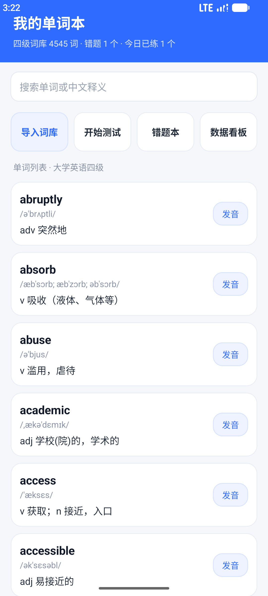
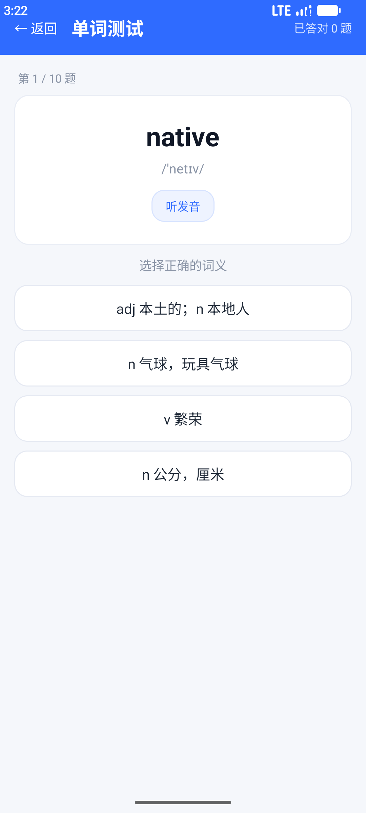
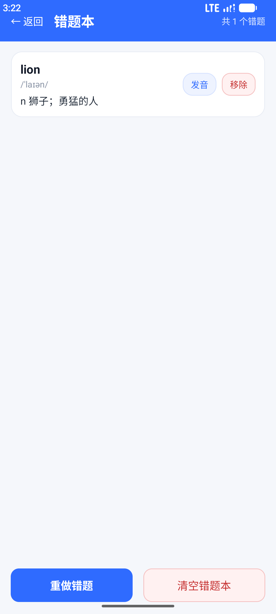
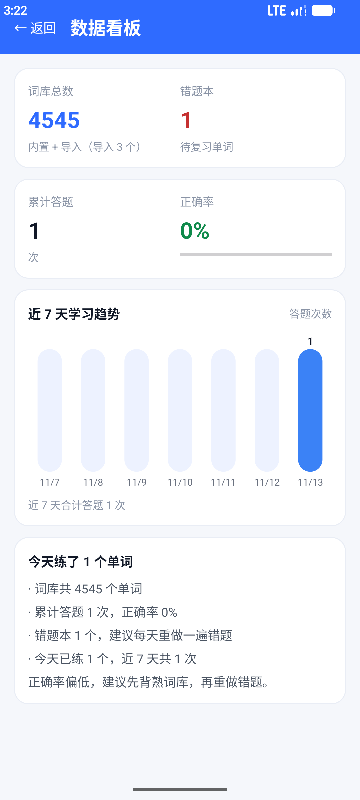

# 单词本（WordNote）

一个基于 Android 原生 Kotlin + XML 的背单词 App，内置 **4545 词大学英语四级词库**，支持搜索、单词测试、错题本、词库导入、数据看板与单词发音。

- 包名：`com.example.iot_test`
- 最低版本：Android 13（minSdk 33），compileSdk 37
- 语言：Kotlin，UI 用传统 View/XML（布局全部 `findViewById`，未用 ViewBinding）

## 作业要求对应

| 作业项 | 实现 |
|---|---|
| **P2 数据看板** | `DashboardActivity` + 自绘 `BarChartView`：词库总数、错题数、累计答题、正确率、近 7 天答题柱状图、今日学习总结与建议 |
| **必做：词库导入** | 通过系统文件选择器（SAF）选 JSON 文件导入，支持 JSON 数组与 `en,音标,中文` 行文本两种格式，按小写去重，导入词与内置词库合并 |
| **必做：错题本模块** | 答错自动入错题本；错题本页可查看、单条移除、清空、**只重做错题**（不足 2 个时拦截并提示） |
| **自选：TTS 单词发音** | 系统 `TextToSpeech`，en-US、语速 0.85，首页每个单词与答题页均可点击朗读 |

## 页面与截图

| 首页（搜索 + 列表 + 四个入口） | 单词测试（10 题四选一） |
|---|---|
|  |  |

| 错题本 | 数据看板 |
|---|---|
|  |  |

## 功能说明

### 1. 首页 `MainActivity`
- 顶部标题与统计副标题：`四级词库 N 词 · 错题 X 个 · 今日已练 Y 个`
- 搜索框：可按英文或中文释义实时过滤
- 四个入口按钮：导入词库 / 开始测试 / 错题本 / 数据看板
- 单词列表：英文、音标、中文释义，右侧「发音」按钮

### 2. 单词测试 `QuizActivity`
- 每次随机抽 10 题，每题 4 个选项（正确释义 + 3 个干扰项）
- 答对：选项变绿并提示「回答正确」
- 答错：所选选项变红、正确选项变绿，并提示「已自动加入错题本」
- 顶部实时显示「已答对 N 题」与进度「第 N / 10 题」
- 每题可点「听发音」朗读当前单词

### 3. 错题本 `WrongBookActivity`
- 展示所有答错过的单词，显示答错次数
- 单条移除、一键清空
- 「重做错题」：只针对错题生成测试；错题不足 2 个时 toast 拦截（干扰项不够）

### 4. 数据看板 `DashboardActivity`
- 词库总数（内置 + 导入）、错题本数量
- 累计答题次数、正确率（带进度条）
- 近 7 天学习趋势柱状图（`BarChartView` 自绘，无需第三方图表库）
- 今日学习总结与建议文案

### 5. 词库与持久化
- 内置词库：`app/src/main/assets/words.json`，4545 词（大学英语四级，含音标与中文释义）
- 导入的词：`filesDir/imported_words.json`
- 错题本：`filesDir/wrong_book.json`
- 学习统计：`SharedPreferences`（`word_app`）
- `WordStore` 内置 `cachedAll` 内存缓存，避免每道题都重新解析 4545 词 JSON

## 项目结构

```
app/src/main/
├── assets/words.json                    # 内置四级词库（4545 词）
├── java/com/example/iot_test/
│   ├── MainActivity.kt                  # 首页：列表 / 搜索 / 导入入口
│   ├── QuizActivity.kt                  # 单词测试
│   ├── WrongBookActivity.kt             # 错题本
│   ├── DashboardActivity.kt             # 数据看板
│   ├── Word.kt                          # 数据模型 en / phonetic / cn
│   ├── WordStore.kt                     # 词库、错题、统计的统一读写
│   ├── WordAdapter.kt                   # 首页列表适配器
│   ├── WrongAdapter.kt                  # 错题本适配器
│   ├── TtsHelper.kt                     # 系统 TTS 封装
│   └── BarChartView.kt                  # 自绘柱状图
└── res/
    ├── layout/                          # 6 个布局文件
    ├── drawable/                        # 卡片 / 输入框 / 按钮 / 选项等背景
    └── values/                          # strings / colors / themes
```

## 运行步骤

1. Android Studio 打开工程根目录，等待 Gradle Sync 完成
2. 启动一个 API 33 及以上的模拟器（或连真机）
3. 点 Run ▶️ 安装运行；也可以在命令行构建：

```bash
# Windows：必须用 Android Studio 自带的 JDK
set JAVA_HOME=D:\android studio\jbr
gradlew.bat assembleDebug
```

APK 输出：`app/build/outputs/apk/debug/app-debug.apk`

## 导入词库格式

支持两种，任选其一保存为 `.json` 或 `.txt` 后在选择器里选中：

```json
[
  { "en": "abandon", "phonetic": "/əˈbændən/", "cn": "v 放弃，抛弃" },
  { "en": "ability", "phonetic": "/əˈbɪləti/", "cn": "n 能力，才能" }
]
```

或按行：

```
abandon,/əˈbændən/,v 放弃，抛弃
ability,/əˈbɪləti/,n 能力，才能
```

导入时按英文小写去重，重复词不会重复计入。

## 说明 / 已知限制

- 单词释义前的词性沿用词库原始缩写（`n` / `v` / `adj` / `adv` 等），未做中文汉化
- 模拟器没有音频输出设备，点发音时系统 Audio HAL 可能打印 `SIGABRT` 日志，属于模拟器问题，App 不会崩溃；真机播放正常
- 界面文字全部为中文且写死在代码/布局里，不跟随系统语言变化
- 文件选择器（系统组件）的显示语言跟随系统语言，其中 `Download` 是文件夹名本身，不会翻译
